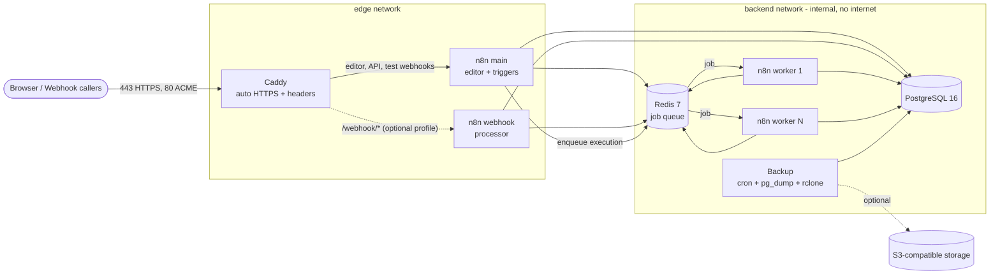

# n8n Production Stack

A production-ready Docker Compose stack for self-hosting [n8n](https://n8n.io) in **queue mode**: scalable workers, optional dedicated webhook processors, PostgreSQL, Redis, automatic HTTPS through Caddy, and scheduled database backups with retention and optional S3 upload.

Maintained by [Saizul Amin](https://saizul.com). MIT licensed.

## Features

- Queue mode (`EXECUTIONS_MODE=queue`): one main instance (editor, triggers, webhooks) and horizontally scalable workers (`--scale n8n-worker=N`).
- Optional dedicated webhook processor, enabled with a Compose profile; Caddy routes `/webhook/*` and `/webhook-waiting/*` to it.
- PostgreSQL 16 and Redis 7 on an **internal-only** Docker network: no published ports.
- Caddy reverse proxy with automatic Let's Encrypt certificates, HTTP/3, compression and security headers.
- Backup container: scheduled `pg_dump` (cron), verified dumps, local retention, optional S3-compatible upload (AWS S3, Backblaze B2, Cloudflare R2, MinIO, Wasabi) via rclone.
- Healthchecks on every service, `restart: unless-stopped`, CPU/memory limits, log rotation, `no-new-privileges`, named volumes.
- Helper scripts and a Makefile for init, backup, restore, update and health checks.
- `.env` preflight check (`make preflight`): catches placeholder or weak secrets, malformed domains and inconsistent profile/S3 settings before anything starts.
- Pinned image versions; CI validates the Compose file, Caddyfile, scripts and YAML, and runs a bats test suite for the scripts.

## Architecture



| Service | Image | Purpose | Networks |
|---|---|---|---|
| `caddy` | `caddy:2.11.9-alpine` | TLS termination, routing, headers | edge |
| `n8n-main` | `docker.n8n.io/n8nio/n8n:2.46.6` | Editor, REST API, triggers, webhooks | edge, backend |
| `n8n-worker` | same | Executes workflows (scalable) | edge (outbound), backend |
| `n8n-webhook` | same | Optional webhook processor (profile `webhook`) | edge, backend |
| `postgres` | `postgres:16.15-alpine` | n8n database | backend only |
| `redis` | `redis:7.4.12-alpine` | Bull job queue (password protected) | backend only |
| `backup` | built from `./backup` (Alpine) | Scheduled dumps, retention, upload | backend, edge |

## Requirements

- A Linux server (1 vCPU / 2 GB RAM minimum, 2 vCPU / 4 GB recommended) with Docker Engine 24+ and the Compose plugin v2.20+.
- A domain name with an `A` (and optionally `AAAA`) record pointing to the server.
- Ports `80` and `443` (TCP, plus `443/udp` for HTTP/3) reachable from the internet. Port 80 is required for the Let's Encrypt HTTP challenge and redirects.
- `openssl` and `bash` on the host (for `scripts/init.sh`).

## DNS

Create a record for the hostname you will use as `N8N_HOST`:

```
n8n.example.com.   300   IN   A      203.0.113.10
n8n.example.com.   300   IN   AAAA   2001:db8::10     ; optional
```

Wait for it to resolve (`dig +short n8n.example.com`) before the first start, otherwise certificate issuance fails and Let's Encrypt may rate-limit retries.

## First run

```bash
git clone https://github.com/saizulamin/n8n-production-stack.git
cd n8n-production-stack

./scripts/init.sh --domain n8n.example.com --email you@example.com
make preflight
make up
make health
```

Open `https://n8n.example.com` and create the owner account. n8n's built-in user management protects the instance, so no extra basic auth layer is needed.

`init.sh` copies `.env.example` to `.env` (mode `600`), generates the PostgreSQL password, Redis password and `N8N_ENCRYPTION_KEY` with `openssl rand`, and refuses to overwrite an existing `.env`.

### Preflight check

`make up` and `scripts/update.sh` run `scripts/preflight.sh` first and stop if `.env` has errors. Run it on its own after editing `.env`:

```bash
make preflight
./scripts/preflight.sh --strict              # also fail on warnings
./scripts/preflight.sh --env-file staging.env --quiet
```

It reads `.env` without evaluating it and never prints secret values. Exit code `0` means no errors, `1` errors (or warnings with `--strict`), `2` a usage error.

| Check | Error | Warning |
|---|---|---|
| Required variables | `N8N_HOST`, `ACME_EMAIL`, `POSTGRES_DB/USER/PASSWORD`, `REDIS_PASSWORD`, `N8N_ENCRYPTION_KEY` missing or empty | |
| Secrets | `CHANGE_ME` placeholders, well-known weak values, passwords under 16 or an encryption key under 32 characters, a single repeated character, `$NAME` that Compose would interpolate, encryption key reused as a password | Postgres and Redis share a password; spaces, quotes, `#` or backslashes |
| Domain and e-mail | Scheme, path, port or invalid FQDN in `N8N_HOST`; malformed `ACME_EMAIL` | Reserved domains (`example.com`, `.test`, `.local`, ...), IP addresses, upper case |
| Versions and tuning | `N8N_VERSION` not an exact `x.y.z`; non-numeric replicas, concurrency or retention; invalid log level or booleans; bad PostgreSQL identifiers | Unusually high replica or concurrency counts, `debug` logging |
| Webhook profile | `COMPOSE_PROFILES=webhook` without `WEBHOOK_UPSTREAM=n8n-webhook:5678`, or the reverse; `N8N_DISABLE_PRODUCTION_MAIN_PROCESS=true` without the profile | Profile enabled while the main process still serves production webhooks |
| Backups | `BACKUP_SCHEDULE` without 5 cron fields; S3 bucket without keys, invalid bucket name, non-AWS provider without an `https://` endpoint | No off-site bucket configured, plain `http://` endpoint |
| File | | `.env` not mode `600`/`400`, CRLF line endings, duplicate keys |

To start the stack while deliberately ignoring the check, call `docker compose up -d` directly.

## Configuration

All settings live in `.env` (see `.env.example` for every option). Key n8n variables the stack sets for you:

| Variable | Value | Notes |
|---|---|---|
| `EXECUTIONS_MODE` | `queue` | Main and workers |
| `QUEUE_BULL_REDIS_HOST/PORT/PASSWORD` | `redis` / `6379` / generated | Redis is not exposed |
| `N8N_ENCRYPTION_KEY` | generated | Identical on every n8n process |
| `DB_TYPE`, `DB_POSTGRESDB_*` | `postgresdb`, `postgres`, ... | Internal network only |
| `N8N_WEBHOOK_URL` | `https://$N8N_HOST/` | Alias `WEBHOOK_URL` on n8n older than 2.30 |
| `N8N_PROXY_HOPS` | `1` | One reverse proxy (Caddy) in front |
| `N8N_RUNNERS_ENABLED` | `true` | Task runners for Code nodes |
| `OFFLOAD_MANUAL_EXECUTIONS_TO_WORKERS` | `true` | Editor test runs use workers too |
| `N8N_DEFAULT_BINARY_DATA_MODE` | `database` | Filesystem mode is not supported in queue mode |
| `QUEUE_HEALTH_CHECK_ACTIVE` | `true` | Enables `/healthz` on workers |
| `EXECUTIONS_DATA_PRUNE` / `_MAX_AGE` | `true` / `336` | Keeps the database small |

Reference: [n8n queue mode](https://docs.n8n.io/hosting/scaling/queue-mode/) and the [environment variable reference](https://docs.n8n.io/hosting/configuration/environment-variables/).

## Scaling workers

```bash
make scale WORKERS=4
# equivalent to
docker compose up -d --no-recreate --scale n8n-worker=4
```

To make it persistent set `N8N_WORKER_REPLICAS=4` in `.env`. Each worker runs `N8N_WORKER_CONCURRENCY` (default 10) executions in parallel, so total capacity is `workers x concurrency`. Keep the PostgreSQL connection count in mind when going far beyond ten workers.

### Dedicated webhook processors (optional)

For high webhook volume, add to `.env`:

```
COMPOSE_PROFILES=webhook
WEBHOOK_UPSTREAM=n8n-webhook:5678
N8N_DISABLE_PRODUCTION_MAIN_PROCESS=true
N8N_WEBHOOK_REPLICAS=2
```

then `make up`. Caddy sends production webhook paths to the processors, while the editor and test webhooks (`/webhook-test/*`) stay on the main instance.

## Backups and restore

The `backup` container runs `pg_dump --format=custom` on `BACKUP_SCHEDULE` (default `0 3 * * *`), validates the dump with `pg_restore --list`, stores it in the `backups` volume and deletes files older than `BACKUP_RETENTION_DAYS`.

```bash
make backup                       # on-demand backup, also copied to ./backups/
make restore FILE=latest          # latest dump in the backup volume
make restore FILE=n8n-n8n-20260101-030000.dump
make restore FILE=/path/to/file.dump
```

`restore.sh` asks you to type `restore`, takes a safety dump first, stops n8n and Caddy, restores in a single transaction, then starts the stack again.

### Off-site copies (S3 / rclone)

Set in `.env`:

```
BACKUP_S3_BUCKET=my-n8n-backups
S3_PROVIDER=AWS            # or Cloudflare, Backblaze, Minio, Wasabi, Other
S3_ENDPOINT=               # required for non-AWS providers
S3_REGION=us-east-1
S3_ACCESS_KEY_ID=...
S3_SECRET_ACCESS_KEY=...
BACKUP_S3_RETENTION_DAYS=30
```

Use a bucket-scoped key with write and delete permission only for that bucket. Then `docker compose up -d backup`.

### What is NOT in the database dump

- `.env`, especially `N8N_ENCRYPTION_KEY`. Store a copy in a password manager. A database restore on a new server needs the **same** key.
- The `n8n_data` volume (`/home/node/.n8n`: instance config, community nodes). Snapshot the host or the volume if you rely on community nodes.

### Test your restores

A backup you have never restored is a hope, not a backup. Verify a dump without touching production:

```bash
make restore-test                 # latest dump in the backup volume
make restore-test FILE=/path/to/file.dump
```

`restore-test.sh` starts a throwaway container from the same PostgreSQL image as the stack (no network, removed afterwards), restores the dump into it and checks that the core n8n tables exist, printing their row counts. The live database and containers are not modified. Still restore into a staging copy of the full stack at least quarterly.

## Upgrading

Image tags are pinned. Never track `latest` on a production system.

```bash
# 1. read the release notes: https://docs.n8n.io/release-notes/
# 2. upgrade n8n to a specific version (pull -> backup -> recreate -> wait for healthy)
make update VERSION=2.46.7
# or refresh the other pinned images after editing the tags in compose.yaml
make update
```

`update.sh` pulls the images first (a wrong tag fails before anything is touched), takes a `pre-update` backup, writes the new `N8N_VERSION` to `.env`, recreates the containers and waits for them to become healthy. To roll back, set the previous `N8N_VERSION`, then `make restore FILE=<pre-update dump>` (database migrations are not reversible), and `make up`.

When bumping PostgreSQL to a new **major** version, do a dump and restore into a fresh volume; the data directory format is not compatible across majors. Keep the `postgresql16-client` package in `backup/Dockerfile` in step with the server major version.

## Security checklist

- [ ] Firewall: allow only `22` (restrict by source IP if possible), `80`, `443/tcp` and `443/udp`. For example `ufw default deny incoming && ufw allow 22 && ufw allow 80 && ufw allow 443`. Note that Docker-published ports bypass `ufw`; this stack only publishes 80 and 443.
- [ ] PostgreSQL and Redis are never published and live on an `internal` network. Do not add `ports:` to them.
- [ ] n8n user management protects the editor: create the owner account immediately after the first start and enable 2FA in your n8n user settings. A separate basic auth layer is not needed.
- [ ] Back up `N8N_ENCRYPTION_KEY` outside the server. Never commit `.env`.
- [ ] Keep `.env` at mode `600` and the host patched (`unattended-upgrades`).
- [ ] Use SSH keys only, disable password login.
- [ ] Off-site backups with a scoped key; test restores regularly.
- [ ] Update on a schedule and read n8n security advisories.
- [ ] Monitor disk usage: execution data, Docker logs (rotated at 5 x 10 MB per container) and backups all grow.

## Repository layout

```
.
├── compose.yaml
├── .env.example
├── Makefile
├── caddy/Caddyfile
├── backup/{Dockerfile,entrypoint.sh,dump.sh}
├── scripts/{common,init,preflight,backup,restore,restore-test,update,healthcheck}.sh
├── tests/*.bats                  # bats suite, Docker stubbed out
├── .github/workflows/ci.yml
├── README.md  TROUBLESHOOTING.md  CHANGELOG.md  CONTRIBUTING.md  LICENSE
```

## Makefile targets

`make help` lists them: `init`, `preflight`, `up`, `down`, `restart`, `logs [SERVICE=]`, `ps`, `backup`, `restore FILE=`, `restore-test FILE=`, `update [VERSION=]`, `scale WORKERS=`, `health`, `config`, `lint`, `test`.

## Tests

The scripts are covered by a [bats-core](https://github.com/bats-core/bats-core) suite in `tests/`. Each test runs against a temporary copy of the repository with `docker` replaced by a stub, so it needs neither Docker nor a `.env`, and never touches a running stack.

```bash
make test            # or: bats tests/
```

## License

[MIT](LICENSE) (c) Saizul Amin

## Prebuilt backup image

The backup container is also published to GitHub Container Registry on every change, for amd64 and arm64:

```bash
docker pull ghcr.io/saizul/n8n-stack-backup:latest
```

The compose file builds it locally by default; you can point the `backup` service at this image instead of `build: ./backup` if you prefer pulling.
